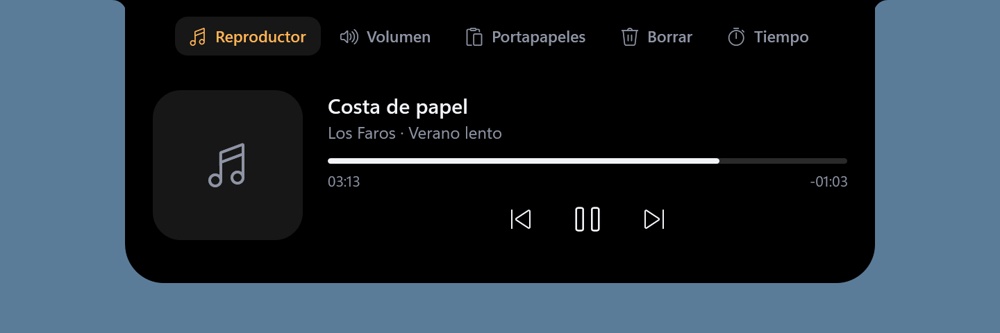
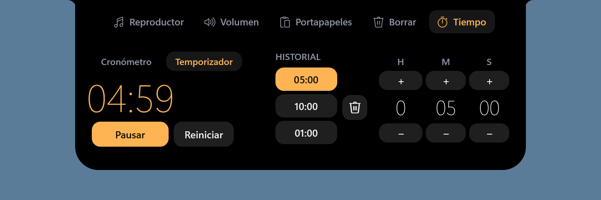
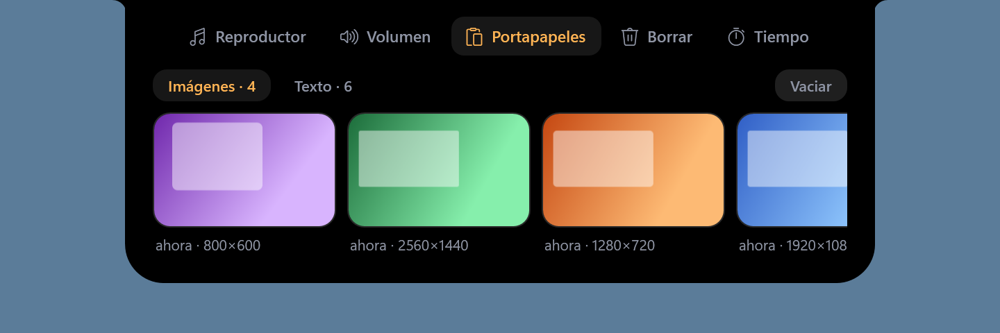
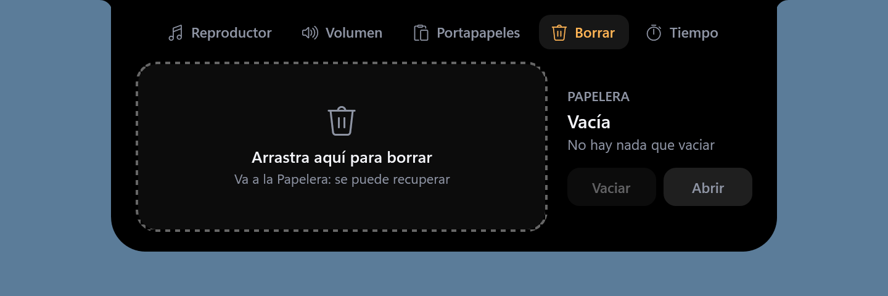

# Alero

**Alero** es una isla dinámica (*Dynamic Island*) y notch para Windows 10 y 11, gratis y sin cuentas.
Vive en el borde superior de la pantalla, se abre al pasar el mouse y controla tu música, el volumen,
el portapapeles y un temporizador sin salir de lo que estás haciendo. Nada sale de tu equipo.

Opciones: **Reproductor** (lo que suena, con controles), **Volumen** (general, por aplicación y salida),
**Portapapeles** (últimas 10 imágenes y 10 textos), **Borrar** (arrastra archivos y van a la Papelera)
y **Tiempo** (cronómetro y temporizador). Las opciones se reordenan arrastrándolas, y el color de
resalte se cambia desde el menú del icono de la bandeja (Color).

<p align="center">
  
  
  
  
  
  
</p>

## Instalar

1. Instala el [.NET 10 Desktop Runtime](https://dotnet.microsoft.com/download/dotnet/10.0).
2. Descarga el `.zip` de la sección **Releases**, descomprímelo y ejecuta `Install-Alero.ps1`
   (clic derecho → Ejecutar con PowerShell).

> **Aviso:** el programa no está firmado digitalmente. Si tienes activado el *Control Inteligente de
> Aplicaciones* de Windows 11, lo bloqueará. Puedes desactivarlo en Seguridad de Windows, o compilarlo tú mismo.

## Compilar

```powershell
dotnet publish -c Release -r win-x64 --self-contained false -o publish
.\Install-Alero.ps1
```

Requiere el SDK de .NET 10 y Windows 10/11.
